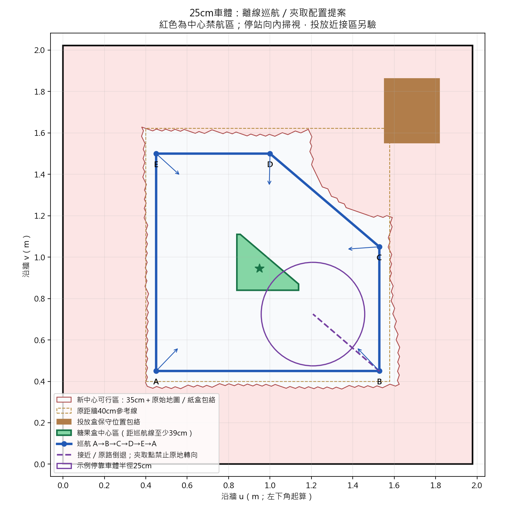

# 25cm 車體：巡航、糖果放置與禁航區自動脫離

本輪僅修改本機程式、產生候選地圖及執行離線測試，沒有連線、部署或移動實車。
車體半徑採使用者更正的 **小於25cm**；環境採使用者聲明的「沒有額外障礙物，只有牆、車體／線材與任務用紙盒」。
固定投放盒仍納入幾何，糖果盒仍由任務影像確認處理。

來源為 GitHub koala `loop-opt-2026-10-21`，commit
[`e8766f03d0de3e48419a488f330b62e3412afab3`](https://github.com/koala915/iGibson-Navigation-Grasping/commit/e8766f03d0de3e48419a488f330b62e3412afab3)。
此版本有退回巡航 mask、依里程計計算倒車實際距離與夾取後沿來路退回，但尚未讓各底盤控制階段共用全域禁航檢查。

## 車體中心與「距牆40cm仍卡住」

巡航位置是 `map -> odom -> base_footprint`，由地圖／AMCL TF 與輪式里程計組合：

```
x_map = tx + cos(yaw_map_odom) * x_odom - sin(yaw_map_odom) * y_odom
y_map = ty + sin(yaw_map_odom) * x_odom + cos(yaw_map_odom) * y_odom
```

這是底盤運動學原點；`base_link` 與它只有8.15cm高度差，沒有平面位移。
不是相機、LiDAR、夾爪或車身外框平均值。程式指定中心不等於已重新尺量確認運動學原點與車體幾何中心重合。
LiDAR 在此原點前方10cm、yaw=π；巡航前方點使用 `x=.10+r*cos(angle+π)`，並非直接拿原始距離當中心距離。

現行實際有多道門檻，下面是假設正對平牆、其他條件皆通過的數值：

|檢查|原本有效門檻|
|---|---|
|中心落在巡航 mask|距擬合牆及原始地圖占用區至少40cm，另排除投放盒|
|正常巡航轉向|中心周圍6cm一圈也要在mask內，等效距牆約46cm|
|0.6秒長點動|預測 `0.35×0.6+0.15=36cm` 仍在mask內，等效中心距牆76cm|
|0.35秒點動|等效中心距牆67.25cm|
|0.15秒點動|等效中心距牆51.25cm|
|0.04秒最短點動|等效中心距牆47.4cm|
|一般前向LiDAR煞停|巡航已換算到車體中心的前方x小於50cm即拒絕；boundary-micro短點動可降35cm|

**76cm僅表示不能選長點動，程式仍會嘗試較短點動；不是76cm就完全不能動。**
因此「中心距牆大於40cm」本身不足以判定可以前進或轉向。
另有影像permit、AMCL／TF／odom／scan新鮮度、手臂travel、唯一owner與回授檢查。
局部接近安全閘另保留LiDAR原點距離；PPO目標另有E1到中心的13.5cm平移，不能混成同一距離。

原始地圖占用像素與擬合牆也不完全一致。例如房間座標 `(1.05,1.5722)`，距擬合牆45cm，
距原始占用像素約37.95cm。這顯示保守地圖／殘留點會另縮空間，不能僅憑肉眼斷言是中心換算錯誤。
保存的兩份巡航末端紀錄距擬合牆約57cm，停止訊息分別是回授確認逾時及影像候選要求停車，並非牆距不足。

程式依據：`deploy/ros/g2_map_patrol.py` 的 `Sensors.state/front_distance/Runner.pulse/rotation_allowed`，
`integration/g2_patrol_policy.py` 的 `allowed/stopping_path_allowed/stop_reserve`，
`deploy/ros/x3plus_tg30_navigation.launch`、`g2_scene_localization.launch`。

## 本機新增自動脫離

`integration/g2_boundary_recovery.py` 與 `deploy/ros/g2_map_patrol.py` 已接入：

1. 將巡航mask視為**軟邊界**，另以25cm全向車體圓＋10cm誤差預算檢查實體牆／固定投放盒。
2. 發現中心在mask外，或正常轉向的6cm餘裕不足，先停穩，搜尋60cm內能回到mask且有7cm轉向餘裕的位置。
3. 整條脫離路徑每5mm檢查；不因起點在軟禁航區就立即拒絕。
4. 選前進或後退以減少轉角；必要時使用0.08秒微轉向。圓形車體包絡涵蓋各朝向，誤差預算保留3cm控制餘裕。
5. 脫離平移命令為0.08m/s、每次0.08秒。持續重讀位姿，檢查預測停止點、位移／角度與進度。
6. 回到可行區且停穩後，重新規劃巡航；限制45秒、總平移65cm、100次點動，不無限重試。

在宣告的空場模式中，正常巡航亦用「地圖停止路徑＋實體牆／投放盒幾何」取代獨立的50cm前方雷射煞停，
避免線材／車體短回波使車誤停。`scan` 新鮮度仍保留，沒有將近回波改寫成自由空間，也沒有擴大自體LiDAR遮罩。
非此環境設定的場景保留原雷射煞停規則。

脫離仍要求新鮮定位／感測、唯一owner、travel且手臂閒置、影像permit允許；
空場幾何模式的平面定位變異數額外限為每軸 `(0.04/3)^2` 以下。協方差是品質閘，不是尺量的絕對誤差保證。
實體幾何淨空不足、位置未知、相機要求停車或回授失效時，不會強行自救。
本機 `scene_layout.json.boundary_recovery.enabled=true`；**未部署，未實機驗收**。

這個分支接在原生巡航入口與行駛中；koala局部接近／放置自己的速度命令尚未改為共用此閘。
投放近接點與伸臂姿態需要另外的定向幾何，不能套用travel圓直接驗收。

## 縮減禁航區與新巡航提案

`navigation_center_mask.proposal.pgm/.yaml` 是35cm候選中心mask；
`navigation_turn_mask.proposal.pgm/.yaml` 是再留6cm的41cm轉向區。
原始AMCL地圖、現用40cm導航mask與現用巡航點檔沒有覆寫。
現有 `Policy` 仍拒絕小於40cm的舊式metadata；候選圖須與後續版本化幾何政策一起啟用，不能只改一個數字。

35cm = 25cm車體＋約10cm預算：定位4cm、牆線1.5cm、2cm格網半對角1.414cm、控制／煞停3cm。
這些是規劃假設，沒有假裝為本輪量測成果。舊自體回波檔存在29cm側向線材紀錄；本輪採使用者最新25cm資訊，未擅改感測遮罩。
車體travel、握物travel與伸臂三種包絡仍需分開核對。

|面積|平方公尺|
|---|---:|
|原中心可行區|1.2232|
|35cm候選中心可行區|1.3756|
|淨增加|0.1524（約12.5%）|
|新增／移除區域|0.1880／0.0356|
|41cm轉向區|1.1188|

有些投放盒附近區域反而移除，因新圖使用完整25cm車體與盒位置包絡，沒有為擴大面積而刪掉紙盒。

房間約1.978×2.022m。座標沿牆，原點為投放盒對角的牆角；正式map座標保存在 `plan.json`。

|點|房間u,v（m）|
|---|---|
|A|0.450,0.450|
|B|1.528,0.450|
|C|1.528,1.050|
|D|1.000,1.500|
|E|0.450,1.500|

巡航 `A→B→C→D→E→A`，切掉投放盒角落。
在站點停穩後向內掃視 `-24° / 0° / +24°`，看到合法糖果目標才接近；
不能假設沿巡航切線行駛就會看見中央目標。

## 糖果盒放置區

圖中綠色多邊形是**糖果盒中心**可放區，不是整個外接矩形：

```
(0.840,0.840), (1.138,0.840), (1.138,0.870),
(0.856,1.110), (0.840,1.110)   # 房間座標m
```

區域約467平方公分；容易尺量的內接小區為 `u=0.86～1.00m, v=0.86～0.96m`。
規劃假設糖果盒底面可放進半徑4cm圓；更大的盒子應增加參數重新生成。
目標中心距整條巡航線至少39cm＝25cm車體＋10cm預算＋4cm糖果盒，避免未夾取前巡航掃過它。

依最新koala的中心到糖果停止距離34cm，驗證了561個區域網格／邊界樣本：
至少一個觀察站可在校正凸包內取得目標（距離約75.0～93.4cm），
直線接近、停靠與原路退回（約41.0～59.4cm）均通過牆、盒包絡與原始已知自由地圖檢查。
夾取後先收妥手臂、沿保存的接近路徑退回站點，再轉向接續任務。
樣本驗證不是對連續區域的數學證明；執行時仍須重新審核實際目標與位姿。



## 重現與驗證

```
python -X utf8 integration/g2_offline_workspace_plan.py
python -X utf8 -m pytest tests/test_g2_boundary_recovery.py tests/test_g2_patrol_policy.py tests/test_g2_patrol_vision_gate.py tests/test_g2_offline_workspace_plan.py tests/test_g2_navigation_goals.py -q
```

79項針對測試通過，涵蓋禁航外前進／倒退／平行牆微轉向自救、短車體回波、真牆拒絕、定位／感測失效停車、
自救後恢復一般導航，以及候選圖與糖果接近／退回幾何。
本輪沒有實車測試；`plan.json` 保留 `hardware_validated=false`、`runtime_enforced=false`（指新35cm配置）、
`error_bounds_verified=false` 與輸入檔SHA256。
